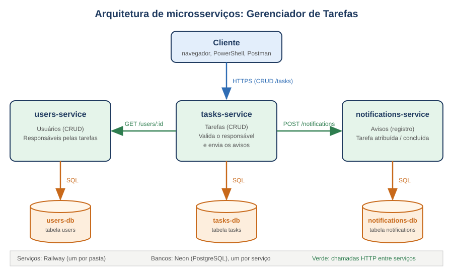

# Gerenciador de Tarefas: Módulo 2 (Microsserviços)

Projeto incremental da disciplina de **Sistemas Distribuídos** (DCC/UERN).

Domínio: **gerenciador de tarefas** (evento natural: "tarefa concluída", usado no Módulo 4).

Neste módulo, a API única do Módulo 1 foi dividida em **3 microsserviços independentes**, cada um com seu código e seu banco de dados, que se comunicam por **HTTP/REST**. O Módulo 1 continua preservado na tag `entrega-1-cloud`.

- Grupo: NOME 1, NOME 2, NOME 3 <!-- TROCAR -->

## Tecnologias e serviços utilizados

O projeto utiliza as seguintes tecnologias e plataformas:

- **Node.js:** desenvolvimento e execução dos microsserviços.
- **Express:** implementação das APIs e rotas HTTP/REST.
- **Railway:** plataforma de hospedagem e publicação dos três microsserviços, permitindo acesso externo às APIs.
- **Neon:** serviço de banco de dados PostgreSQL em nuvem, utilizado para armazenar os dados de cada microsserviço de forma independente.
- **Git e GitHub:** versionamento e gerenciamento do código-fonte.

## Infraestrutura em nuvem

A infraestrutura do projeto foi distribuída entre duas plataformas:

- **Railway:** responsável pela hospedagem e execução dos serviços `tasks-service`, `users-service` e `notifications-service`, disponibilizando suas APIs por meio de URLs públicas.
- **Neon:** responsável pelo armazenamento dos dados, com bancos PostgreSQL independentes para cada microsserviço (`tasks-db`, `users-db` e `notifications-db`).

Essa separação permite que cada serviço mantenha seu próprio banco de dados, respeitando o princípio de independência de dados da arquitetura de microsserviços.

## URLs públicas (Railway)

| Serviço | URL |
|---|---|
| tasks-service | https://tasks-service-production-dd13.up.railway.app |
| users-service | https://users-service-production-9f90.up.railway.app |
| notifications-service | https://notifications-service-production-c3c4.up.railway.app |

Verificação rápida no navegador: abra [/health/dependencias](https://tasks-service-production-dd13.up.railway.app/health/dependencias). Deve mostrar `{"tasks":"ok","users":"ok","notifications":"ok"}`.

## Arquitetura



| Serviço | Responsabilidade | Banco (Neon) | Porta local |
|---|---|---|---|
| tasks-service | CRUD de tarefas; valida o responsável e dispara avisos | tasks-db | 3000 |
| users-service | CRUD de usuários (responsáveis) | users-db | 3001 |
| notifications-service | Registra avisos (tarefa atribuída e concluída) | notifications-db | 3002 |

Chamadas entre serviços:
- tasks-service chama users-service: `GET /users/:id` (síncrono; confirma que o responsável existe).
- tasks-service chama notifications-service: `POST /notifications` (não bloqueia a resposta).


## Como testar a comunicação na nuvem

Qualquer pessoa pode repetir estes testes contra os serviços publicados. Basta um terminal com `curl` (Linux/macOS) ou PowerShell (Windows).

### 1. Verificação rápida no navegador

- [tasks-service /health/dependencias](https://tasks-service-production-dd13.up.railway.app/health/dependencias)
- [users-service /health](https://users-service-production-9f90.up.railway.app/health)
- [notifications-service /health](https://notifications-service-production-c3c4.up.railway.app/health)

### 2. Fluxo completo: Linux/macOS (curl)

```bash
T=https://tasks-service-production-dd13.up.railway.app
U=https://users-service-production-9f90.up.railway.app
N=https://notifications-service-production-c3c4.up.railway.app

curl -s $T/health/dependencias; echo

USERID=$(curl -s -X POST $U/users -H "Content-Type: application/json" -d "{\"nome\":\"Maria Silva\",\"email\":\"maria$RANDOM@exemplo.com\"}" | sed -n 's/.*"id":\([0-9]*\).*/\1/p')
echo "id do usuário: $USERID"

TID=$(curl -s -X POST $T/tasks -H "Content-Type: application/json" -d "{\"titulo\":\"Fazer relatorio\",\"responsavel_id\":$USERID}" | sed -n 's/.*"id":\([0-9]*\).*/\1/p')
echo "id da tarefa: $TID"

curl -s $T/tasks/$TID; echo

sleep 3
curl -s "$N/notifications?task_id=$TID"; echo

curl -s -X PUT $T/tasks/$TID -H "Content-Type: application/json" -d '{"status":"concluida"}'; echo

sleep 3
curl -s "$N/notifications?task_id=$TID"; echo

curl -s $T/tasks/$TID/completo; echo
```

### 3. Fluxo completo: Windows (PowerShell)

```powershell
$T = "https://tasks-service-production-dd13.up.railway.app"
$U = "https://users-service-production-9f90.up.railway.app"
$N = "https://notifications-service-production-c3c4.up.railway.app"

Invoke-RestMethod -Uri "$T/health/dependencias"

$u = Invoke-RestMethod -Method Post -Uri "$U/users" -ContentType "application/json; charset=utf-8" -Body (@{nome="Maria Silva"; email="maria$(Get-Random)@exemplo.com"} | ConvertTo-Json)

$t = Invoke-RestMethod -Method Post -Uri "$T/tasks" -ContentType "application/json; charset=utf-8" -Body (@{titulo="Fazer relatorio"; responsavel_id=$u.id} | ConvertTo-Json)

Invoke-RestMethod -Uri "$T/tasks/$($t.id)"

Start-Sleep -Seconds 3
Invoke-RestMethod -Uri "$N/notifications?task_id=$($t.id)"

Invoke-RestMethod -Method Put -Uri "$T/tasks/$($t.id)" -ContentType "application/json; charset=utf-8" -Body '{"status":"concluida"}'

Start-Sleep -Seconds 3
Invoke-RestMethod -Uri "$N/notifications?task_id=$($t.id)"

Invoke-RestMethod -Uri "$T/tasks/$($t.id)/completo"
```

### Resultado esperado

| Etapa | O que deve aparecer |
|---|---|
| 1 | Os três serviços com status `ok` |
| 2 | Usuário criado com `id` |
| 3 | Tarefa associada ao usuário |
| 4 | Aviso de tarefa atribuída |
| 5 | Tarefa concluída e aviso correspondente |
| 6 | Dados completos do responsável |

## Endpoints

- **tasks-service:** `GET /health`, `GET /health/dependencias`, `POST /tasks`, `GET /tasks`, `GET /tasks/:id`, `GET /tasks/:id/completo`, `PUT /tasks/:id`, `DELETE /tasks/:id`
- **users-service:** `GET /health`, `POST /users`, `GET /users`, `GET /users/:id`, `PUT /users/:id`, `DELETE /users/:id`
- **notifications-service:** `GET /health`, `POST /notifications`, `GET /notifications`, `GET /notifications/:id`

## Variáveis de ambiente

| Serviço | Variável | Descrição |
|---|---|---|
| Todos | `DATABASE_URL` | Connection string do banco PostgreSQL hospedado no Neon |
| Todos | `PORT` | Porta definida pelo Railway |
| tasks-service | `USERS_SERVICE_URL` | URL base do users-service |
| tasks-service | `NOTIFICATIONS_SERVICE_URL` | URL base do notifications-service |
| tasks-service | `REQUEST_TIMEOUT_MS` | Timeout das chamadas (padrão 5000 ms) |

Localmente, copie o `.env.example` de cada pasta para `.env`.

Na nuvem, as variáveis ficam configuradas no painel do Railway, incluindo as conexões com os bancos de dados do Neon.

Nenhum segredo deve ser enviado ao GitHub.

## Como rodar localmente

Requisitos: Node.js 18+ e acesso a três bancos de dados PostgreSQL. O projeto utiliza o Neon como serviço de banco de dados na nuvem.

```bash
cd users-service && npm install && cp .env.example .env && npm start
cd notifications-service && npm install && cp .env.example .env && npm start
cd tasks-service && npm install && cp .env.example .env && npm start
```

(Um terminal para cada serviço; configure o `.env` de cada um antes de iniciar.)

As tabelas são criadas automaticamente.

Os testes também podem ser executados localmente, utilizando `http://localhost:3000` (tasks), `http://localhost:3001` (users) e `http://localhost:3002` (notifications).

## Justificativa técnica

- **3 serviços com responsabilidades distintas:** cada um cuida de um assunto e pode ser alterado e publicado sem mexer nos outros.
- **Um banco por serviço:** isolamento; um serviço só acessa os dados de outro pela API dele.
- **Railway:** permite hospedar e disponibilizar os microsserviços por URLs públicas.
- **Neon:** fornece bancos PostgreSQL independentes para cada microsserviço.
- **HTTP síncrono para o users-service:** a tarefa só deve ser criada se o responsável existir.
- **Aviso sem bloquear:** avisos são secundários; se falharem, a tarefa não pode ser perdida. No Módulo 4 isso evolui para mensageria.
- **Timeout em toda chamada:** evita que um serviço lento trave quem o consome.
- **Monorepo com uma pasta por serviço:** simples de versionar e publicar no Railway com Root Directory.
