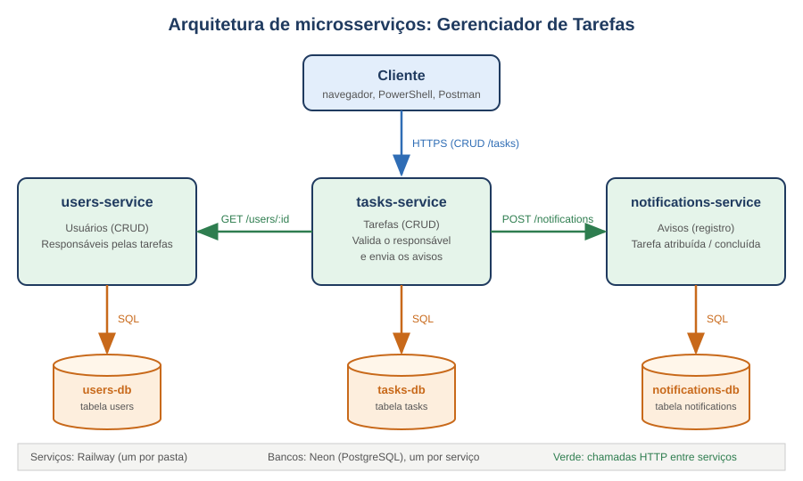

# Gerenciador de Tarefas

Projeto incremental da disciplina de **Sistemas Distribuídos** (DCC/UERN).  
**Docente(s):** Glaucia Melissa (Responsável pela disciplina) / Luiziane Paulino dos Santos (Estágio Docência)  
**Domínio:** Gerenciador de tarefas (evento natural: *"tarefa concluída"*, base para o Módulo 4).

Histórico de entregas e módulos preservados nas tags do Git:
- `entrega-1-cloud`: Módulo 1 — API monolítica inicial publicada em nuvem com banco gerenciado (Neon/Railway).
- `entrega-2-microsservicos`: Módulo 2 — Decomposição em 3 microsserviços independentes com comunicação síncrona HTTP/REST.
- `entrega-3-containers`: Módulo 3 — Conteinerização individual via Dockerfile e orquestração completa via Docker Compose com bancos locais e volumes persistentes.

---

## Módulo 3 — Containers e Docker Compose (Novidade)

Neste módulo, todos os componentes do sistema foram empacotados em containers padronizados e orquestrados localmente de forma autônoma:

### Vídeo de Demonstração (Módulo 3)

> [!IMPORTANT]
> **Link do Vídeo no YouTube (Não Listado):** `[INSERIR_LINK_AQUI]`  
> *(Demonstração dos 6 containers subindo via Docker Compose, execução do teste de comunicação e validação da persistência dos dados após `docker-compose down` / `docker-compose up`)*.

### O que foi implementado:
1. **Dockerfile individual para cada microsserviço:**
   - Construção com **multi-stage build** baseada na imagem enxuta `node:20-alpine` (~49 MB compactada).
   - Separação entre estágio de instalação de dependências (`dependencies`) e estágio de execução (`runner`).
   - Execução com usuário sem privilégios (`USER node`) para segurança de containers.
   - Instrução `HEALTHCHECK` nativa validando `/health` via `wget`.
   - Tratamento de encerramento gracioso (*graceful shutdown*) capturando `SIGTERM` e `SIGINT`.
   - Arquivo `.dockerignore` configurado em cada pasta.

2. **Orquestração Completa via `docker-compose.yml`:**
   - 3 microsserviços Node.js/Express (`tasks-service`, `users-service`, `notifications-service`).
   - 3 instâncias de banco PostgreSQL 16 Alpine independentes (`users-db`, `tasks-db`, `notifications-db`), preservando o isolamento de dados de microsserviços.
   - **Volumes persistentes nomeados:** `gerenciador_users_db_data`, `gerenciador_tasks_db_data` e `gerenciador_notifications_db_data`.
   - **Inicialização determinística:** healthchecks nos bancos (`pg_isready`) combinados com `depends_on: { condition: service_healthy }`.
   - Rede interna dedicada do Docker (`gerenciador-network`).

3. **Arquitetura de Containers (Topologia Local):**
   ```
                          [ Host / Navegador / curl ]
                                       |
             +-------------------------+-------------------------+
             | :3000                   | :3001                   | :3002
             v                         v                         v
     +-----------------+       +-----------------+       +-----------------------+
     |  tasks-service  | ----> |  users-service  |       | notifications-service |
     | (Node.js Alpine)|  HTTP | (Node.js Alpine)|       |   (Node.js Alpine)    |
     +-----------------+  REST +-----------------+       +-----------------------+
             |                         |                             |
             | HTTP (async fire&forget)|                             |
             +-------------------------|-----------------------------+
             |                         |                             |
             v                         v                             v
     +-----------------+       +-----------------+       +-----------------------+
     |    tasks-db     |       |    users-db     |       |   notifications-db    |
     | (Postgres 16)   |       | (Postgres 16)   |       |     (Postgres 16)     |
     +-----------------+       +-----------------+       +-----------------------+
             |                         |                             |
             v                         v                             v
     [(vol) tasks_data]        [(vol) users_data]        [(vol) notifications_data]
   ```

### Mapeamento de Serviços, Portas e Volumes

| Container | Imagem Base | Porta Interna | Porta no Host | Volume Persistente |
|---|---|---|---|---|
| `users-db` | `postgres:16-alpine` | 5432 | 5431 | `gerenciador_users_db_data` |
| `tasks-db` | `postgres:16-alpine` | 5432 | 5432 | `gerenciador_tasks_db_data` |
| `notifications-db` | `postgres:16-alpine` | 5432 | 5433 | `gerenciador_notifications_db_data` |
| `users-service` | Multi-stage `node:20-alpine` | 3001 | 3001 | — |
| `tasks-service` | Multi-stage `node:20-alpine` | 3000 | 3000 | — |
| `notifications-service` | Multi-stage `node:20-alpine` | 3002 | 3002 | — |

---

### Como Rodar via Docker Compose (Linux, macOS ou Windows 11)

#### 1. Iniciar todos os serviços e bancos:
```bash
docker compose up --build -d
```
*(ou `docker-compose up --build -d`)*

#### 2. Verificar a saúde dos containers:
```bash
docker compose ps
```
Todos os 6 containers devem exibir `Up (healthy)`.

#### 3. Testar a comunicação entre os microsserviços:
- No Linux/macOS:
  ```bash
  ./scripts/test-endpoints.sh
  ```
- No Windows (PowerShell):
  ```powershell
  .\scripts\test-endpoints.ps1
  ```

#### 4. Executar o Teste de Persistência Documentado:
O teste comprova que os dados permanecem salvos nos volumes após destruir os containers com `docker compose down`:
- No Linux/macOS:
  ```bash
  ./scripts/test-persistence.sh
  ```
- No Windows (PowerShell):
  ```powershell
  .\scripts\test-persistence.ps1
  ```

#### 5. Parar os containers mantendo os volumes de dados:
```bash
docker compose down
```

---

## Comparação Técnica: Deploy Direto na Nuvem (Módulos 1 e 2) vs. Containers (Módulo 3)

| Critério de Análise | Deploy Direto na Nuvem (Módulos 1 e 2) | Execução via Containers (Módulo 3) |
|---|---|---|
| **Ambiente de Execução** | Depende do runtime do provedor (Railway instalando Node via buildpack; Neon gerenciando instâncias Postgres). | Imagens imutáveis e isoladas via Docker (`node:20-alpine` e `postgres:16-alpine`), idênticas em qualquer máquina ou SO. |
| **Reprodução Local** | Trabalhosa: exigia clonar o repo, instalar versão compatível de Node.js, rodar `npm install` em 3 pastas, abrir 3 terminais e configurar manualmente 3 bancos no Neon ou local. | Imediata: um único comando (`docker compose up --build -d`) sobe toda a topologia distribuída (6 containers) sem exigir Node ou Postgres instalados no host. |
| **Paridade Dev/Prod** | Baixa: discrepâncias de versão de Node, bibliotecas do SO ou portas no host podiam gerar comportamentos inesperados ("na minha máquina funciona"). | Alta: todo o ambiente (SO Alpine, dependências, variáveis, rede e banco) é declarado em código (`Infrastructure as Code`). |
| **Segurança e Privilégios** | Processos Node rodando com usuário padrão do host ou da VM. | Isolamento de namespace por container e execução com usuário não-root (`USER node`), limitando a superfície de ataque. |
| **Persistência de Dados** | Delegada a serviço PaaS (Neon com storage em nuvem gerenciado). | Gerenciada explicitamente pelo grupo através de **Docker Volumes nomeados** independentes por microsserviço. |

### O que mudou?
- Antes, a aplicação dependia de serviços externos (Neon e Railway) e do ambiente local previamente configurado.
- Agora, a aplicação e seus bancos foram empacotados em artefatos versionáveis (imagens Docker e manifesto Compose), permitindo execução 100% *offline*, padronizada e portátil.

### O que ficou mais fácil?
- **Subida em lote com um comando:** Inicialização de 6 serviços com resolução automática de portas e redes internas.
- **Ordem de inicialização determinística:** Com `healthcheck` e `depends_on`, os microsserviços não quebram tentando conectar em bancos que ainda não terminaram o boot.
- **Isolamento de dependências:** Nenhuma dependência precisa estar instalada no host além do próprio Docker.

### O que ficou mais difícil / Desafios enfrentados?
- **Gerenciamento de volumes:** Exigiu atenção para não perder dados com comandos destrutivos (diferença entre `down` e `down -v`).
- **Comunicação inter-containers:** Substituição de `localhost` por nomes de serviços do Compose (`users-service`, `tasks-db`, etc.) e controle de DNS interno na rede Docker.
- **Tratamento de sinais:** Necessidade de implementar captura de `SIGTERM`/`SIGINT` no Node.js para encerramento limpo sem timeout de 10s.

---

## Módulo 2 — Infraestrutura em Nuvem (Railway e Neon)

A infraestrutura publicada na nuvem durante o Módulo 2 continua ativa e disponível:

- **Railway:** responsável pela hospedagem e execução dos serviços `tasks-service`, `users-service` e `notifications-service`, disponibilizando suas APIs por meio de URLs públicas.
- **Neon:** responsável pelo armazenamento dos dados, com bancos PostgreSQL independentes para cada microsserviço (`tasks-db`, `users-db` e `notifications-db`).

### URLs públicas (Railway)

| Serviço | URL |
|---|---|
| `tasks-service` | https://tasks-service-production-dd13.up.railway.app |
| `users-service` | https://users-service-production-9f90.up.railway.app |
| `notifications-service` | https://notifications-service-production-c3c4.up.railway.app |

Verificação rápida no navegador: abra [/health/dependencias](https://tasks-service-production-dd13.up.railway.app/health/dependencias). Deve mostrar `{"tasks":"ok","users":"ok","notifications":"ok"}`.

### Diagrama de Arquitetura do Módulo 2



| Serviço | Responsabilidade | Banco (Neon) | Porta local |
|---|---|---|---|
| tasks-service | CRUD de tarefas; valida o responsável e dispara avisos | tasks-db | 3000 |
| users-service | CRUD de usuários (responsáveis) | users-db | 3001 |
| notifications-service | Registra avisos (tarefa atribuída e concluída) | notifications-db | 3002 |

Chamadas entre serviços:
- tasks-service chama users-service: `GET /users/:id` (síncrono; confirma que o responsável existe).
- tasks-service chama notifications-service: `POST /notifications` (não bloqueia a resposta).

---

## Como testar a comunicação na nuvem (Railway)

### Fluxo Linux/macOS (curl)
```bash
T=https://tasks-service-production-dd13.up.railway.app
U=https://users-service-production-9f90.up.railway.app
N=https://notifications-service-production-c3c4.up.railway.app

curl -s $T/health/dependencias; echo

USERID=$(curl -s -X POST $U/users -H "Content-Type: application/json" -d "{\"nome\":\"Maria Silva\",\"email\":\"maria$RANDOM@exemplo.com\"}" | sed -n 's/.*"id":\([0-9]*\).*/\1/p')
echo "id do usuário: $USERID"

TID=$(curl -s -X POST $T/tasks -H "Content-Type: application/json" -d "{\"titulo\":\"Fazer relatorio\",\"responsavel_id\":$USERID}" | sed -n 's/.*"id":\([0-9]*\).*/\1/p')
echo "id da tarefa: $TID"

curl -s $T/tasks/$TID; echo

sleep 3
curl -s "$N/notifications?task_id=$TID"; echo

curl -s -X PUT $T/tasks/$TID -H "Content-Type: application/json" -d '{"status":"concluida"}'; echo

sleep 3
curl -s "$N/notifications?task_id=$TID"; echo

curl -s $T/tasks/$TID/completo; echo
```

### Fluxo Windows (PowerShell)
```powershell
$T = "https://tasks-service-production-dd13.up.railway.app"
$U = "https://users-service-production-9f90.up.railway.app"
$N = "https://notifications-service-production-c3c4.up.railway.app"

Invoke-RestMethod -Uri "$T/health/dependencias"

$u = Invoke-RestMethod -Method Post -Uri "$U/users" -ContentType "application/json; charset=utf-8" -Body (@{nome="Maria Silva"; email="maria$(Get-Random)@exemplo.com"} | ConvertTo-Json)

$t = Invoke-RestMethod -Method Post -Uri "$T/tasks" -ContentType "application/json; charset=utf-8" -Body (@{titulo="Fazer relatorio"; responsavel_id=$u.id} | ConvertTo-Json)

Invoke-RestMethod -Uri "$T/tasks/$($t.id)"

Start-Sleep -Seconds 3
Invoke-RestMethod -Uri "$N/notifications?task_id=$($t.id)"

Invoke-RestMethod -Method Put -Uri "$T/tasks/$($t.id)" -ContentType "application/json; charset=utf-8" -Body '{"status":"concluida"}'

Start-Sleep -Seconds 3
Invoke-RestMethod -Uri "$N/notifications?task_id=$($t.id)"

Invoke-RestMethod -Uri "$T/tasks/$($t.id)/completo"
```

---

## Endpoints das APIs

- **tasks-service:** `GET /health`, `GET /health/dependencias`, `POST /tasks`, `GET /tasks`, `GET /tasks/:id`, `GET /tasks/:id/completo`, `PUT /tasks/:id`, `DELETE /tasks/:id`
- **users-service:** `GET /health`, `POST /users`, `GET /users`, `GET /users/:id`, `PUT /users/:id`, `DELETE /users/:id`
- **notifications-service:** `GET /health`, `POST /notifications`, `GET /notifications`, `GET /notifications/:id`

## Variáveis de Ambiente

| Serviço | Variável | Descrição |
|---|---|---|
| Todos | `DATABASE_URL` | Connection string do banco PostgreSQL (Neon ou container local) |
| Todos | `PORT` | Porta do serviço |
| Todos | `PGSSL` | Define se exige SSL (`true` para Neon na nuvem; `false` para Docker local) |
| tasks-service | `USERS_SERVICE_URL` | URL base do users-service |
| tasks-service | `NOTIFICATIONS_SERVICE_URL` | URL base do notifications-service |
| tasks-service | `REQUEST_TIMEOUT_MS` | Timeout das chamadas HTTP (padrão 5000 ms) |

---

## Como Rodar Localmente sem Docker (Manual)

Requisitos: Node.js 18+ e instâncias do PostgreSQL acessíveis.

```bash
cd users-service && npm install && cp .env.example .env && npm start
cd notifications-service && npm install && cp .env.example .env && npm start
cd tasks-service && npm install && cp .env.example .env && npm start
```

As tabelas são criadas automaticamente pelos scripts de inicialização de cada microsserviço.
